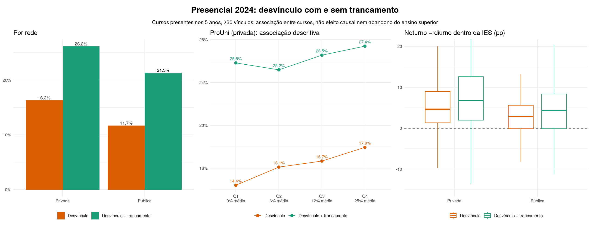

```{r}
#| label: setup
#| include: false
suppressPackageStartupMessages({library(data.table); library(knitr)})
source("scripts/modelo/variantes.R")   # funções do modelo; não ajusta nada ao ser carregado
POP <- "filtrada"
VAR <- "outputs/modelo/variantes/filtrada"
br  <- function(x, d = 1) formatC(x, format = "f", digits = d, big.mark = ".", decimal.mark = ",")
pct <- function(x, d = 1) paste0(br(100 * x, d), "%")
tab <- function(x, ...) kable(x, format.args = list(big.mark = ".", decimal.mark = ","), ...)
```

## Como ler este documento {.unnumbered}

Este documento reúne, em uma única leitura, **todo o caminho da análise**: dos dados
públicos do Censo da Educação Superior até o modelo estatístico adotado, seus testes,
diagnósticos e resultados. Cada seção explica **o que foi feito, por que foi feito e
como ler o resultado**. O código está recolhido. Clique em *Mostrar código* para vê-lo.

Por padrão, o documento **lê os resultados já calculados** pelos scripts do
repositório, em vez de refazê-los. Os ajustes completos levam horas. Para refazer tudo
do zero, renderize com `-P reexecutar:true` (veja a [Seção @sec-reproducao]).

Três cuidados valem para todo o texto:

1. **Os dados são agregados por curso**, não por aluno. Os resultados descrevem cursos, e
   não explicam por que cada estudante saiu.
2. **Associação não é causa.** Os coeficientes mostram quais características andam junto
   com taxas maiores ou menores, depois de comparar cursos da mesma instituição e cada
   curso consigo mesmo ao longo do tempo. Eles não provam que mudar essas características
   mudaria a taxa.
3. **A medida inclui o trancamento**, que pode ser temporário. Não é a evasão oficial do
   INEP nem abandono definitivo do ensino superior.

```{r}
#| label: reexecucao
#| include: false
# Com reexecutar = true, refaz o pipeline na ordem correta (horas de processamento).
if (isTRUE(params$reexecutar)) {
  passos <- list(
    c("scripts/modelo/preparar.R"),
    c("scripts/modelo/testar_variantes.R"),
    c("scripts/eda/eda_composta.R"),
    c("scripts/modelo/variantes.R", "base", "completo", "--populacao=filtrada"),
    c("scripts/modelo/variantes.R", "base", "treino", "--populacao=filtrada"),
    c("scripts/modelo/variantes.R", "dispre", "completo", "--populacao=filtrada"),
    c("scripts/modelo/variantes.R", "dispre", "treino", "--populacao=filtrada"),
    c("scripts/modelo/variantes_integrada.R", "--populacao=filtrada", "--sorteios=200"),
    c("scripts/modelo/variantes_diagnosticar.R", "base", "--populacao=filtrada"),
    c("scripts/modelo/variantes_diagnosticar.R", "dispre", "--populacao=filtrada"),
    c("scripts/modelo/variantes_hessiana.R", "dispre", "--populacao=filtrada"),
    c("scripts/modelo/figuras_pitch.R"))
  for (p in passos) stopifnot(system2("Rscript", p) == 0)
}
```

# A pergunta e a medida

**Pergunta.** Quais características dos cursos e da composição dos seus estudantes se
associam à proporção anual de alunos que **perdem o vínculo ou trancam** o curso,
comparando cursos dentro da mesma instituição e cada curso ao longo de 2020–2024?

**Medida.** Para cada curso *i* no ano *t*:

$$
\text{taxa}_{it} = \frac{\text{desvinculados}_{it} + \text{trancados}_{it}}{\text{vínculos}_{it}},
\qquad
\text{vínculos} = \text{matriculados} + \text{trancados} + \text{desvinculados} + \text{transferidos} + \text{falecidos}.
$$

- **Desvinculado:** perdeu o vínculo com o curso sem se formar (abandono, cancelamento,
  jubilamento).
- **Trancado:** pausou o curso e pode voltar.
- **Transferido:** mudou para outro curso da mesma instituição. Fica no denominador, mas
  não conta como saída.

Incluímos o trancamento por dois motivos. Ele é uma forma de interrupção que precede
muitas desistências. Além disso, as instituições parecem registrar de formas diferentes o
que é "trancado" e o que é "desvinculado": a [Seção @sec-eda] mostra que somar as duas
categorias muda conclusões importantes.

# Dados e população analisada {#sec-dados}

A fonte é a tabela `cursos_ano` do Censo da Educação Superior (INEP), com uma linha por
curso e ano, de 2020 a 2024. Analisamos uma **população estável**:

- **cursos presentes nos cinco anos** (`presente_5_anos == 1`): compara-se a mesma oferta
  ao longo do tempo, sem misturar a abertura e o fechamento de cursos com a evolução das
  taxas;
- **curso-anos com 30 vínculos ou mais** (`poucos_alunos == 0`): evita taxas instáveis,
  em que um único aluno muda vários pontos percentuais;
- **matrículas positivas no ano**.

```{r}
#| label: populacao
d <- populacao(POP)
bruto <- nanoparquet::read_parquet("data/raw/cursos_ano.parquet")
resumo_pop <- data.table(
  Etapa = c("Base completa (curso-anos)", "Com matrículas positivas", "População analisada"),
  `Curso-anos` = c(nrow(bruto), sum(bruto$matriculas > 0), nrow(d)))
tab(resumo_pop)
```

A população analisada tem **`r br(nrow(d), 0)` curso-anos**, **`r br(uniqueN(d$co_curso), 0)`
cursos** e **`r br(uniqueN(d$co_ies), 0)` instituições**. O preço dessa escolha é que os
resultados valem para cursos estabelecidos e não muito pequenos. Cursos que fecharam no
período, possivelmente em crise, ficam de fora.

Todas as taxas agregadas abaixo **somam numeradores e denominadores** antes de dividir.
Uma média simples de taxas daria o mesmo peso a um curso de 30 e a um de 30.000 alunos.

```{r}
#| label: taxas-ano
anual <- d[, .(`Desvínculo + trancamento` = pct(sum(eventos_resposta) / sum(vinculos)),
               `Só desvínculo` = pct(sum(desvinculados) / sum(vinculos)),
               `Só trancamento` = pct(sum(trancados) / sum(vinculos))), by = .(Ano = ano)]
tab(anual[order(Ano)], align = "lrrr")
mod <- dcast(d[, .(t = sum(eventos_resposta) / sum(vinculos)), by = .(modalidade, ano)],
             modalidade ~ ano, value.var = "t")
mod[, (2:6) := lapply(.SD, pct), .SDcols = 2:6]; setnames(mod, "modalidade", "Modalidade")
tab(mod, caption = "Desvínculo + trancamento por modalidade e ano")
```

**Leitura.** A taxa sobe de cerca de 30% para 33,5% entre 2020 e 2024. A alta vem do
**EAD**, que passa de 33% para 41%; o presencial cai levemente. O desvínculo sobe, e o
trancamento cai depois de 2021.

# Análise exploratória com trancamento {#sec-eda}

A análise exploratória da equipe (`notebooks/02_EDA.ipynb`, branch `sanches`) usou só o
desvínculo. O script `scripts/eda/eda_composta.R` refaz as mesmas comparações, com as
mesmas definições de grupos, mostrando **as duas medidas lado a lado**. Para o
desvínculo, reproduz exatamente os números do notebook original.

```{r}
#| label: eda-rede
rm_ <- fread("outputs/eda/tabelas/rede_modalidade.csv")
tab(rm_[, .(Rede = rede, Modalidade = modalidade, `Só desvínculo` = pct(desvinculo),
            `Só trancamento` = pct(trancamento), `Desvínculo + trancamento` = pct(composta))],
    caption = "Taxas 2020–2024 por rede e modalidade", align = "llrrr")
```

No EAD público, o trancamento **mais que dobra** a taxa. Olhar só o desvínculo
subestimaria muito a interrupção nesse grupo.

```{r}
#| label: fig-painel
#| fig-cap: "Painel-síntese para o pitch: presencial 2024, as duas medidas lado a lado."

```

```{r}
#| label: eda-achados
nd <- fread("outputs/eda/tabelas/noturno_diurno_intra_ies.csv")
pu <- fread("outputs/eda/tabelas/prouni_quartis_2024.csv")
ep <- fread("outputs/eda/tabelas/escola_publica_quartis.csv")
g  <- function(m, r = "Total") nd[medida == m & rede == r]
achados <- data.table(
  Comparação = c("Noturno − diurno na mesma IES (mediana, presencial 2024)",
                 "  … rede privada", "  … rede pública",
                 "ProUni, privada 2024: 1º → 4º quartil de cobertura",
                 "Escola pública, privada presencial: 1º → 4º quartil"),
  `Só desvínculo` = c(paste0("+", br(g("Desvínculo")$mediana_pp), " pp"),
                      paste0("+", br(g("Desvínculo", "Privada")$mediana_pp), " pp"),
                      paste0("+", br(g("Desvínculo", "Pública")$mediana_pp), " pp"),
                      paste(pct(pu$desvinculo[1]), "→", pct(pu$desvinculo[4])),
                      paste(pct(ep[rede == "Privada"]$desvinculo[1]), "→", pct(ep[rede == "Privada"]$desvinculo[4]))),
  `Desvínculo + trancamento` = c(paste0("+", br(g("Desvínculo + trancamento")$mediana_pp), " pp"),
                      paste0("+", br(g("Desvínculo + trancamento", "Privada")$mediana_pp), " pp"),
                      paste0("+", br(g("Desvínculo + trancamento", "Pública")$mediana_pp), " pp"),
                      paste(pct(pu$composta[1]), "→", pct(pu$composta[4])),
                      paste(pct(ep[rede == "Privada"]$composta[1]), "→", pct(ep[rede == "Privada"]$composta[4]))))
tab(achados, align = "lrr")
```

**Leitura dos achados exploratórios** (associações sem controles):

- **Turno noturno.** Comparamos, **dentro da mesma instituição**, cursos
  predominantemente noturnos (≥ 70% dos alunos) com predominantemente diurnos (≤ 30%).
  Em `r br(g("Desvínculo + trancamento")$IES, 0)` instituições com os dois tipos, os
  noturnos têm taxa mediana **`r br(g("Desvínculo + trancamento")$mediana_pp)` pp maior**,
  e a diferença é positiva em `r pct(g("Desvínculo + trancamento")$positiva, 0)` delas. A
  diferença *cresce* quando o trancamento entra. É o achado exploratório mais robusto.
- **ProUni.** Olhando só o desvínculo, cursos com mais bolsistas parecem perder mais
  alunos. Somando o trancamento, a relação **quase desaparece**: esses cursos trancam
  menos e desvinculam mais, e a interrupção total quase não muda. Não se deve dizer que o
  ProUni "aumenta" a desistência.
- **Escola pública.** Na rede privada, a taxa sobe do 1º para o 2º quartil de egressos de
  escola pública e depois estabiliza. A relação é mais fraca que no desvínculo isolado.

Essas comparações não controlam área, porte, perfil etário e outras diferenças entre
cursos. O modelo da [Seção @sec-modelo] faz isso.

# Por que um modelo estatístico, e por que este {#sec-escolha}

As tabelas acima misturam muitas diferenças entre cursos ao mesmo tempo. Para saber se
uma característica continua associada à taxa **mantendo as demais constantes**, usamos um
modelo de regressão. Ele precisa respeitar quatro fatos dos dados:

1. **A resposta é uma contagem dentro de um total** (Y alunos de N). Uma taxa de 30% em
   um curso de 40 alunos é bem menos precisa que em um de 4.000.
2. **Há mais variação do que um sorteio binomial explicaria** (sobredispersão): cursos
   parecidos têm taxas bem diferentes.
3. **Os dados têm estrutura**: o mesmo curso aparece cinco vezes, e cursos da mesma
   instituição se parecem.
4. **Nenhum curso com matrículas perde todos os vínculos no ano** (Y < N), e o modelo
   não deve dar probabilidade a algo impossível.

A escolha final passou por várias tentativas, registradas em `docs/historico.md`:

- **O modelo anterior** era uma beta-binomial truncada com efeitos aleatórios só na média.
  Ele deixava um padrão em **S** nos resíduos (worm-plots), sinal de **caudas mais pesadas**
  do que o modelo previa.
- **Famílias alternativas não resolveram:** binomial, beta-binomial com zeros inflados e
  binomial dupla (pacote gamlss), e Box-Cox t sobre a proporção. A Box-Cox t mostrou que o
  problema era de curtose, mas errava por porte e dava probabilidade a valores
  impossíveis.
- **O que resolveu** foi permitir que a **dispersão também varie entre instituições e
  cursos**. Com um único grau de sobredispersão para todos, os cursos "instáveis" e os
  "estáveis" ficam misturados, e essa mistura é o que gera caudas pesadas.

# O modelo adotado {#sec-modelo}

Para o curso *i* da instituição *j* no ano *t*, com $N_{it}$ vínculos e $Y_{it}$ desvínculos
ou trancamentos:

$$
\begin{aligned}
Y_{it} \mid p_{it} &\sim \text{Binomial}(N_{it},\, p_{it}) \quad\text{condicionado a } Y_{it} < N_{it},\\
p_{it} &\sim \text{Beta com média } \mu_{it} \text{ e precisão } \phi_{it},\\
\operatorname{logit}(\mu_{it}) &= \mathbf{x}_{it}^\top \boldsymbol\beta + u_j + u_i, & u_j &\sim N(0,\sigma^2_{\text{IES}}),\ u_i \sim N(0,\sigma^2_{\text{curso}}),\\
\log(\phi_{it}) &= \mathbf{z}_{it}^\top \boldsymbol\gamma + v_j + v_i, & v_j &\sim N(0,\tau^2_{\text{IES}}),\ v_i \sim N(0,\tau^2_{\text{curso}}).
\end{aligned}
$$

Em palavras:

- **Média ($\mu$).** É a taxa "típica" do curso naquele ano. Depende de:
  - ano, modalidade, categoria administrativa, organização acadêmica, grau e área Cine;
  - **sete perfis dos matriculados**: % mulheres, % pretos/pardos/indígenas (PPI), % com
    25 anos ou mais, % de escola pública, % com deficiência, % por reserva de vagas e % no
    noturno;
  - o porte do curso e dez características médias da instituição.
- **Efeitos de instituição e de curso na média ($u_j$, $u_i$).** Capturam tudo o que é
  estável em cada instituição e em cada curso e não está nas variáveis. Por isso os
  coeficientes comparam, na prática, cursos *dentro* da mesma instituição e cada curso
  consigo mesmo ao longo dos anos.
- **Precisão ($\phi$).** Mede quanto a taxa varia em torno da média: $\phi$ alto significa
  taxa estável. Depende de ano × modalidade e do porte, e tem **efeitos próprios de
  instituição e de curso ($v_j$, $v_i$)**. Essa é a novidade do modelo adotado.
- **Truncagem em Y < N.** A probabilidade de "todos saíram" é removida e o restante é
  renormalizado.

Os parâmetros são estimados por **máxima verossimilhança com aproximação de Laplace**,
que integra os cerca de 70 mil efeitos aleatórios, usando o pacote TMB. A
verossimilhança está escrita em C++:

```{r}
#| label: cpp
#| class-output: cpp
#| code-fold: show
cat(readLines("scripts/modelo/bb_truncada_dispre.cpp"), sep = "\n")
```

## Testes da implementação

Antes de usar o modelo, a implementação foi conferida em casos pequenos
(`scripts/modelo/testar_variantes.R`):

```{r}
#| label: testes
f <- ".cache/modelo/testes/variantes.json"
if (file.exists(f)) {
  t <- jsonlite::read_json(f)
  e <- unlist(t[c("erro_bd_zero", "erro_densidade", "erro_gradiente", "erro_laplace_glmmTMB")])
  tab(data.table(
    Teste = c("Com efeitos de dispersão zerados, reproduz o modelo anterior",
              "Densidade igual à fórmula escrita em R",
              "Gradiente igual a diferenças finitas",
              "Aproximação de Laplace igual à do pacote glmmTMB"),
    `Erro máximo` = ifelse(e == 0, "0 (idêntico)",
                           sub("e", " × 10^", formatC(e, format = "e", digits = 1, decimal.mark = ",")))), align = "lr")
} else cat("Rode scripts/modelo/testar_variantes.R para gerar este quadro.")
```

Além disso, a densidade do modelo anterior foi conferida contra uma conta exata
independente (produtos, sem funções gama), com erro máximo de 5 × 10⁻¹². Os resíduos
usados nos diagnósticos foram conferidos em dados simulados do próprio modelo: saem
uniformes, como deveriam.

# Ajuste e comparação de variantes {#sec-ajuste}

Cada variante foi ajustada duas vezes: na **população completa** e no **treino**, que
exclui um ano sorteado de cada curso. Esse ano separado forma a **reserva**, usada na
[Seção @sec-reserva]. Comparamos:

- **`base`**: o modelo anterior (efeitos aleatórios só na média), reajustado nesta
  população;
- **`dispre`**: o modelo adotado (efeitos de instituição e de curso também na
  dispersão);
- **`dispre_ies`**: dispersão aleatória só por instituição (resumo salvo; modelo não mantido);
- **`dispre_fase`**: `dispre` mais um indicador de curso sem ingressantes no ano (idem).

```{r}
#| label: aic
# Resumo salvo dos ajustes; os modelos das variantes não adotadas foram removidos do repositório.
aj <- fread(file.path(VAR, "comparacao/tabelas/variantes_aic.csv"))
tab(aj[order(AIC)][, .(Variante = variante, Parâmetros = parametros, AIC = br(AIC, 0),
                       `ΔAIC` = br(dAIC, 0), Convergiu = convergencia == 0)], align = "lrrrl")
th <- exp(readRDS(variant_path("dispre", "completo", POP))$parameters$theta)
```

**Leitura.** O **AIC** (critério de Akaike) mede o ajuste penalizado pelo número de
parâmetros; menor é melhor, e diferenças de milhares de pontos são enormes.

- Pôr efeitos aleatórios na dispersão reduz o AIC em cerca de **56 mil** com só dois
  parâmetros a mais.
- A dispersão por instituição sozinha (`dispre_ies`) já faz 94% do ganho. A variabilidade
  das taxas é, sobretudo, uma característica **da instituição**, o que é compatível com
  práticas diferentes de registro e de gestão acadêmica.
- O indicador "sem ingressantes" acrescenta pouco.

No modelo adotado, o desvio-padrão do efeito de instituição na log-precisão é
**`r br(th[3], 2)`** e o de curso é **`r br(th[4], 2)`**. Uma instituição um desvio-padrão
acima da média tem precisão cerca de `r br(exp(th[3]), 1)` vezes maior, ou seja, taxas
bem mais estáveis de um ano para outro.

# Validação em anos reservados {#sec-reserva}

Um bom ajuste nos dados usados para estimar não garante boa previsão. Por isso
**reservamos um ano de cada curso** (30.982 curso-anos), reajustamos o modelo sem eles e
avaliamos a previsão desses anos. Os efeitos de cada instituição e curso são estimados com
incerteza, e essa incerteza é levada em conta: sorteamos 200 vezes esses efeitos da sua
distribuição aproximada e fazemos a média das previsões.

```{r}
#| label: reserva
ri <- fread(file.path(VAR, "comparacao/tabelas/reserva_integrada_resumo.csv"))
tab(ri[, .(Variante = variante, `Log-score médio` = br(logscore_medio, 3), `Pearson²` = br(pearson2, 2),
           `Taxa prevista` = pct(taxa_prev, 2), `Taxa observada` = pct(taxa_obs, 2),
           `Desvio central do worm` = br(media_desvio_central, 2), `Desvio das caudas` = br(media_desvio_caudas, 2))],
    align = "lrrrrrr")
```

**Como ler.**

- O **log-score** é a média do logaritmo da probabilidade que o modelo deu ao que de fato
  aconteceu. Quanto maior (menos negativo), melhor. Ele penaliza tanto errar o centro
  quanto ser confiante demais.
- O **Pearson²** compara a variabilidade observada com a prevista; o ideal é 1.
- Os **desvios do worm** resumem os worm-plots abaixo.

O modelo adotado tem log-score claramente melhor (−4,17 contra −4,38), acerta melhor a
taxa agregada e reduz as caudas mal ajustadas em mais da metade. Seu Pearson² de 1,20
indica previsões um pouco **estreitas demais**, uma limitação conhecida.

```{r}
#| label: fig-reserva
#| fig-cap: "Worm-plots dos anos reservados por modalidade e porte. Linhas: base (modelo anterior), dispre (adotado) e dispre_fase."
include_graphics(file.path(VAR, "comparacao/graficos/worm_reserva_integrada.png"))
```

**Como ler um worm-plot.**

- Cada ponto compara um quantil dos resíduos com o que se esperaria se o modelo estivesse
  certo. Um modelo adequado gera uma "minhoca" **horizontal em torno de zero**, dentro das
  curvas tracejadas (bandas de 95%).
- Um **S** indica caudas erradas.
- Uma **inclinação** indica variabilidade errada.

No grupo mais numeroso (presencial, 100 a 999 vínculos), o S forte do modelo anterior vira
uma minhoca quase plana.

# Diagnóstico por simulação {#sec-diagnostico}

O último teste é simular 500 vezes os dados a partir do modelo ajustado e perguntar se
os dados reais "parecem" uma dessas simulações. Fazemos isso em três níveis:

- **condicional:** fixa os efeitos estimados de cada instituição e curso;
- **IES fixa:** fixa só os de instituição e sorteia os de curso;
- **marginal:** sorteia tudo.

```{r}
#| label: diag
lerdiag <- function(v) {
  p <- file.path(VAR, v, "diagnostico/tabelas")
  g <- fread(file.path(p, "diagnosticos.csv"))[estatistica != "fronteira_superior"]
  u <- fread(file.path(p, "resumo_PIT.csv"))
  i <- fread(file.path(p, "calibracao_ies.csv"))[, .(ies = mean(observado < sim_p025 | observado > sim_p975)), by = contexto]
  dt <- fread(file.path(p, "dependencia_temporal.csv"))
  list(g = g, u = u, i = i, dt = dt)
}
b <- lerdiag("base"); a <- lerdiag("dispre")
val <- function(x, ctx, st) x$g[contexto == ctx & estatistica == st]$razao_obs_sim
cmp <- data.table(
  Medida = c("Zeros observados ÷ simulados (condicional)", "Zeros observados ÷ simulados (marginal)",
             "Pearson² observado ÷ simulado (marginal)", "Maior afastamento do QQ uniforme (condicional)",
             "IES com taxa fora do envelope de 95% (condicional)", "Correlação dos resíduos de anos seguidos (condicional)"),
  Ideal = c("1", "1", "1", "0", "≈ 5%", "0"),
  `Modelo anterior` = c(br(val(b, "condicional", "zeros"), 2), br(val(b, "marginal", "zeros"), 2),
                        br(val(b, "marginal", "dispersao_padronizada"), 2),
                        br(b$u[contexto == "condicional"]$maior_afastamento_uniforme, 3),
                        pct(b$i[contexto == "condicional"]$ies), br(b$dt[contexto == "condicional"]$correlacao, 3)),
  `Modelo adotado` = c(br(val(a, "condicional", "zeros"), 2), br(val(a, "marginal", "zeros"), 2),
                       br(val(a, "marginal", "dispersao_padronizada"), 2),
                       br(a$u[contexto == "condicional"]$maior_afastamento_uniforme, 3),
                       pct(a$i[contexto == "condicional"]$ies), br(a$dt[contexto == "condicional"]$correlacao, 3)))
tab(cmp, align = "lrrr")
```

**Leitura.**

- O modelo anterior previa **quase metade dos zeros** observados (cursos sem nenhuma
  saída no ano); o adotado chega perto, e no nível marginal fica dentro do intervalo das
  simulações.
- A distribuição dos resíduos condicionais fica praticamente uniforme: o afastamento cai
  de 0,084 para 0,015.
- Menos instituições ficam fora do envelope de 95%, e quase não sobra correlação entre
  anos seguidos do mesmo curso.

```{r}
#| label: fig-diag
#| fig-cap: "Worm-plots do modelo adotado nos três níveis de simulação, por modalidade e porte."
include_graphics(file.path(VAR, "dispre/diagnostico/graficos/worm_modalidade_porte.png"))
```

**O que ainda não está bom.**

- **Cursos muito grandes** (1.000 ou mais vínculos), sobretudo presenciais, quando o efeito
  do curso não é condicionado (linha do meio).
- Um S moderado no nível marginal.
- Erros de calibração de até cerca de 3 pp em alguns grupos de EAD grande.

# Estabilidade e resultados {#sec-resultados}

```{r}
#| label: hessiana
inf <- jsonlite::read_json(file.path(VAR, "dispre/inferencia/inferencia.json"))
```

Para que os erros-padrão façam sentido, o otimizador precisa ter de fato chegado ao
máximo da verossimilhança.

- Calculamos a matriz de curvatura (**Hessiana**) dos 66 parâmetros e demos um passo de
  Newton.
- O maior gradiente caiu de **`r br(inf$gradiente_max_antes, 1)`** para
  **`r br(inf$gradiente_max_newton, 2)`**, e a Hessiana é **positiva definida** (menor
  autovalor `r br(inf$autovalor_min, 2)`): o ponto é um máximo bem definido.

```{r}
#| label: coeficientes
cf <- fread(file.path(VAR, "dispre/inferencia/tabelas/coeficientes.csv"))
rotulo <- c(p_feminino = "Mulheres", p_ppi = "Pretos, pardos e indígenas", p_25_anos_ou_mais = "25 anos ou mais",
            p_escola_publica = "Egressos de escola pública", p_deficiencia = "Com deficiência (+1 pp)",
            p_reserva_vagas = "Ingresso por reserva de vagas", p_noturno = "No turno noturno")
taxa_media <- sum(d$eventos_resposta) / sum(d$vinculos)
pf <- cf[termo %in% names(rotulo)]
pf[, `:=`(Perfil = rotulo[termo],
          pp = 100 * estimativa * taxa_media * (1 - taxa_media))]
setorder(pf, -estimativa)
tab(pf[, .(`Perfil dos matriculados (+10 pp)` = Perfil,
           `Razão de chances` = br(razao_chances_subjacente, 3),
           `IC 95%` = paste0(br(rc_ic95_inf, 3), " – ", br(rc_ic95_sup, 3)),
           `≈ variação na taxa (pp)` = paste0(ifelse(pp >= 0, "+", ""), br(pp, 2)))], align = "lrrr")
```

```{r}
#| label: fig-perfis
#| fig-cap: "Variação aproximada da taxa anual para +10 pp de cada perfil no curso, com IC 95%."
include_graphics(file.path(VAR, "dispre/figuras/perfis_efeito_pp.png"))
```

**Como ler.**

- A **razão de chances** compara as chances de desvínculo ou trancamento quando a
  proporção daquele perfil no curso aumenta **10 pontos percentuais** (1 pp para
  deficiência), mantendo constantes as demais variáveis, a instituição e o próprio curso.
  Acima de 1, a taxa tende a ser maior; abaixo de 1, menor.
- A última coluna traduz o coeficiente em pontos percentuais para um curso com a taxa
  média da população (`r pct(taxa_media)`). É uma aproximação para variações pequenas.

**Leitura dos resultados.**

- Cursos com mais estudantes de **25 anos ou mais**, **PPI**, **egressos de escola
  pública** e **no noturno** têm taxas maiores. O noturno confirma, agora com controles, o
  achado exploratório da comparação dentro da mesma instituição.
- Cursos com mais **mulheres** e mais **ingressantes por reserva de vagas** têm taxas
  menores.
- Os efeitos por perfil são **pequenos individualmente**, de décimos de ponto percentual
  por 10 pp. Os perfis tendem a aparecer juntos (estudante mais velho, que trabalha,
  estuda à noite e veio da escola pública), e o efeito combinado é maior.
- Com 150 mil observações, quase tudo é estatisticamente "significativo". Por isso
  destacamos o **tamanho** das associações, não os valores-p.

```{r}
#| label: ead
ead <- cf[grepl("^modalidadeEAD$|^ano20..:modalidadeEAD$", termo)]
tab(ead[, .(Termo = termo, `Razão de chances` = br(razao_chances_subjacente, 2),
            `IC 95%` = paste0(br(rc_ic95_inf, 2), " – ", br(rc_ic95_sup, 2)))], align = "lrr")
```

```{r}
#| label: fig-ead
#| fig-cap: "Taxas observadas por modalidade (esquerda) e razão de chances da interação ano × EAD no modelo (direita)."
#| layout-ncol: 2
include_graphics(file.path(VAR, c("dispre/figuras/ead_presencial_taxas.png", "dispre/figuras/ead_interacao_ano.png")))
```

Em 2020, os cursos EAD tinham chances menores que presenciais comparáveis (razão 0,61).
Mas a interação ano × EAD cresce ano a ano e chega a 1,48 em 2024: **o EAD se afasta do
presencial ao longo do período**, coerente com a alta de 33% para 41% vista nos dados
brutos.

## Os achados exploratórios têm base inferencial? {#sec-eda-inferencia}

A análise exploratória comparava grupos sem controlar outras diferenças. O modelo
oferece uma base mais forte, porque compara cursos **dentro da mesma instituição**. Faz
isso de dois modos: pelo efeito aleatório de instituição e pela inclusão das **médias
institucionais de cada perfil**, uma técnica conhecida como correção de Mundlak, que
separa a parte "entre instituições" da parte "dentro da instituição". Cada perfil é
avaliado com os demais, a área, o porte, a modalidade e o ano constantes.

```{r}
#| label: eda-vs-modelo
co <- function(t) cf[termo == t]
rc <- function(t, d = 2) with(co(t), paste0(br(razao_chances_subjacente, d), " (", br(rc_ic95_inf, d), "–", br(rc_ic95_sup, d), ")"))
nt <- co("p_noturno")
nt_rc <- paste0(br(exp(10 * nt$estimativa), 2), " (", br(exp(10 * (nt$estimativa - 1.96 * nt$ep)), 2), "–",
                br(exp(10 * (nt$estimativa + 1.96 * nt$ep)), 2), ")")
nt_pp <- 100 * 10 * nt$estimativa * taxa_media * (1 - taxa_media)
tab(data.table(
  `Achado da exploração (sem controles)` = c(
    paste0("Noturno − diurno na mesma IES: +", br(g("Desvínculo + trancamento")$mediana_pp), " pp"),
    "Mais egressos de escola pública, taxa maior",
    "EAD se afasta do presencial ao longo dos anos",
    "Rede pública abaixo da privada",
    "Saúde com taxas baixas; Engenharia e TIC altas (só desvínculo)",
    "ProUni: gradiente no desvínculo, plano na medida composta"),
  `O que o modelo estima (IC 95%)` = c(
    paste0("Curso 100% noturno × 0%: RC ", nt_rc, ", ≈ +", br(nt_pp), " pp"),
    paste0("RC ", rc("p_escola_publica", 3), " por +10 pp"),
    paste0("Ano × EAD: ", rc("ano2021:modalidadeEAD"), " em 2021 até ", rc("ano2024:modalidadeEAD"), " em 2024"),
    paste0("Federal ", rc("categoria_administrativaPública Federal"), "; estadual ",
           rc("categoria_administrativaPública Estadual"), "; municipal ", rc("categoria_administrativaPública Municipal")),
    paste0("Saúde ", rc("cine_area_geral09"), "; Engenharia ", rc("cine_area_geral07"), "; TIC ",
           rc("cine_area_geral06"), " (contra Negócios)"),
    "Não está no modelo"),
  `Base inferencial` = c("Sim; o efeito cai à metade com os controles", "Sim; efeito pequeno", "Sim; forte",
                         "Sim", "Em parte; Engenharia e TIC invertem", "Não; só descritivo")),
  align = "lll")
```

```{r}
#| label: fig-noturno
#| fig-cap: "Noturno − diurno: comparação direta dentro das IES (laranja) e estimativa do modelo com controles (azul, IC 95%)."
include_graphics(file.path(VAR, "dispre/figuras/noturno_bruto_ajustado.png"))
```

**Leitura.**

- **Noturno.** O achado mais forte da exploração se sustenta: um curso inteiramente
  noturno tem taxa cerca de **`r br(nt_pp)` pp maior** que um diurno comparável da mesma
  instituição.
  - A diferença bruta era maior porque parte dela vinha da idade e da origem escolar, que
    andam junto com o noturno.
  - Instituições com mais cursos noturnos também têm taxas maiores
    (RC `r rc("ies_m_p_noturno")` por +10 pp na média da IES).
- **Área.** A ordem bruta entre áreas não se mantém por inteiro. Depois dos controles,
  Engenharia e TIC ficam *abaixo* de Negócios. Isso mostra por que comparar taxas brutas
  pode enganar.
- **ProUni.** Não há base inferencial. Incluí-lo exigiria reajustar o modelo, e o
  resultado descritivo já indica que o ProUni muda a composição entre trancar e
  desvincular, mais do que a taxa total.

Estes intervalos dependem da especificação e da aproximação de Laplace. Com 150 mil
observações, intervalos estreitos são esperados, e o **tamanho** de cada associação
importa mais que a significância. Os achados destacados foram definidos pela exploração
antes do modelo, e não escolhidos entre muitos coeficientes.

# Limitações {#sec-limites}

- **Dados agregados:** os perfis descrevem quem está matriculado, não quem saiu. São
  associações "ecológicas", sujeitas a seleção e sobrevivência: quem sai deixa de compor
  o perfil do ano seguinte.
- **Medida:** o trancamento pode ser temporário. Não há dados individuais para saber quantos
  trancamentos viram desistência.
- **População:** cursos estáveis com 30 vínculos ou mais. Os resultados não se estendem a
  cursos pequenos ou que fecharam.
- **Variáveis fora do modelo:**
  - FIES: os zeros intermitentes em grandes instituições parecem falta de registro;
  - ProUni e apoio social: não incluídos;
  - qualidade dos cursos, contexto territorial e PNAES: não incluídos.
- **Ajuste:** persistem problemas em cursos muito grandes e previsões um pouco estreitas
  em anos reservados.
- **Validação retrospectiva:** os anos reservados já orientaram a escolha entre variantes.
  Não é previsão de futuro nem de cursos novos.
- **Incerteza:** os erros-padrão dependem da aproximação de Laplace e da especificação
  escolhida. A seleção de perfis por AIC não foi feita.

# Reprodução {#sec-reproducao}

Todo o ambiente é declarado em `flake.nix` (R, pacotes, Quarto). A partir da raiz do
repositório:

```bash
nix develop -c quarto render pipeline_modelo.qmd                    # lê resultados salvos (minutos)
nix develop -c quarto render pipeline_modelo.qmd -P reexecutar:true # refaz tudo (horas)
```

Os scripts, em ordem, estão em `scripts/modelo/` e `scripts/eda/`. As decisões e
tentativas descartadas estão em `docs/historico.md`, os métodos em `docs/metodologia.md`
e o uso de IA em `docs/registro_uso_ia_modelagem.md`.
